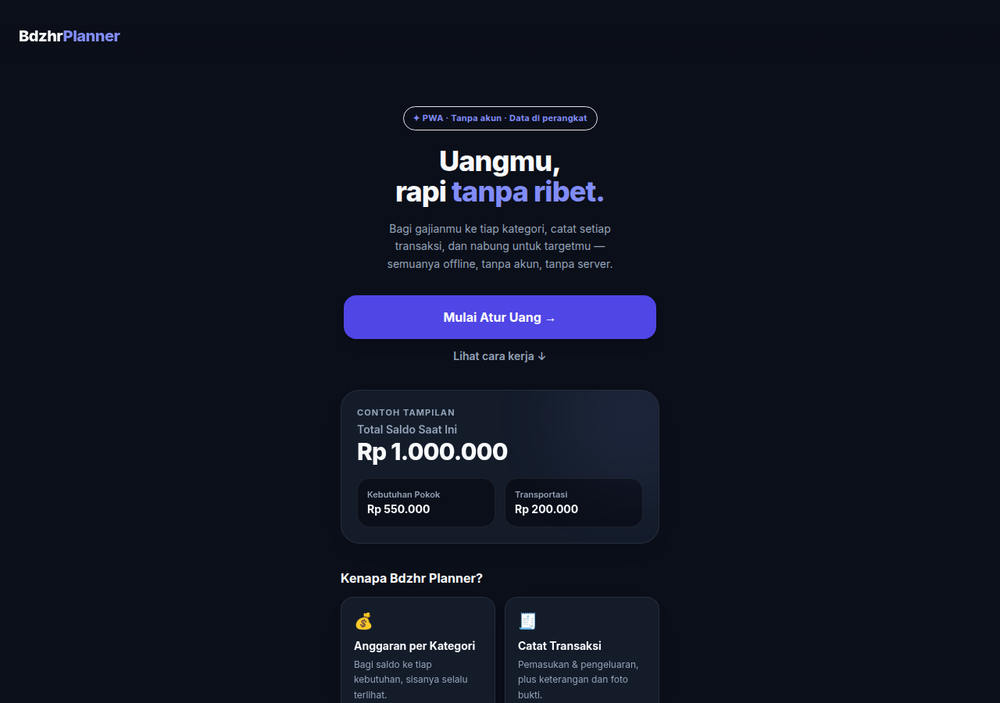
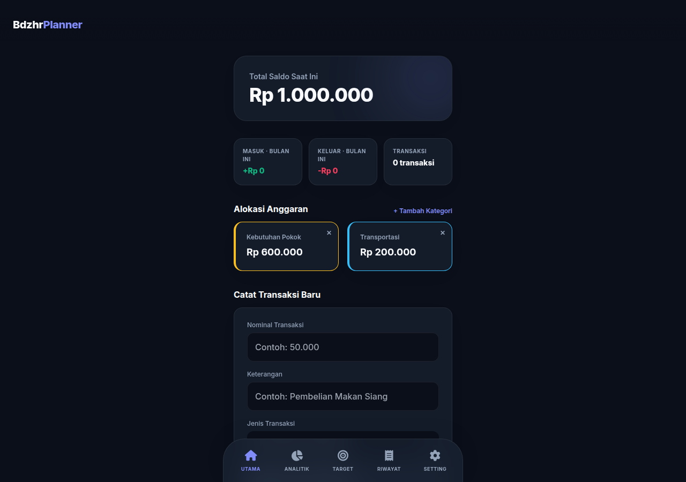
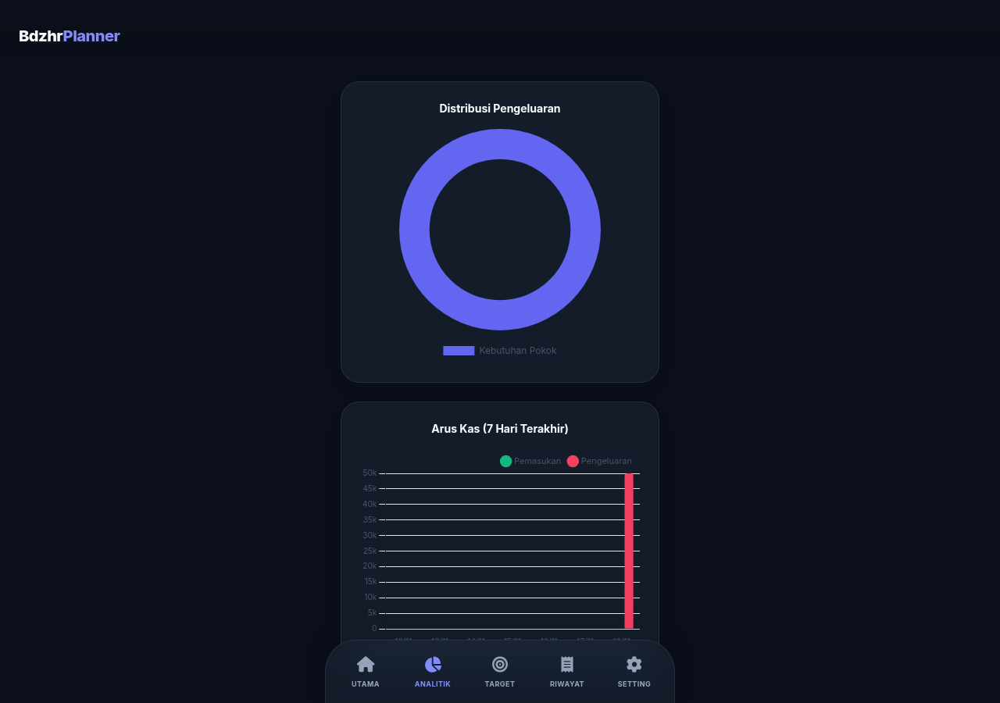

# Bdzhr Planner

Perencana keuangan pribadi — atur saldo awal dan anggaran per kategori, catat pemasukan/pengeluaran, kejar target menabung, lihat analitik, dan ekspor laporan. Berupa PWA satu halaman yang bisa di-install dan dibuka offline.

🌐 **Live:** https://planku.pages.dev

[](https://github.com/dezzorigin/bdzhr-planner/actions/workflows/ci.yml)

## Tangkapan layar

| Landing | Dashboard | Analitik |
|---|---|---|
|  |  |  |

## Demo video

[](docs/demo/demo.mp4)

> Klik gambar di atas untuk memutar video demo (9 detik, tanpa suara — direkam headless, tanpa audio). GitHub tidak menampilkan tag `<video>` di README, jadi demo disajikan sebagai tautan.

## Fitur

- **Landing page** — halaman depan yang menjelaskan apa itu Bdzhr Planner (hero, fitur, cara kerja) sebelum masuk ke setup; tampil pertama kali bagi pengguna baru.
- **Setup awal** — isi saldo awal, lalu alokasi anggaran per kategori (bawaan: Kebutuhan Pokok, Transportasi; bisa tambah/hapus).
- **Dashboard** — total saldo saat ini, ringkasan bulan ini (masuk/keluar/jumlah transaksi), dan sisa tiap kategori anggaran. Tambah kategori langsung dari form inline di dashboard.
- **Transaksi** — pemasukan, pengeluaran tak terduga, atau pengeluaran per kategori, lengkap dengan keterangan dan foto bukti (opsional, tersimpan sebagai base64 di perangkat).
- **Target menabung (wishlist)** — buat target barang, nabung bertahap dari saldo utama, progres bar sampai 100%.
- **Analitik** — diagram donat distribusi pengeluaran per kategori dan grafik batang arus kas 7 hari terakhir (Chart.js).
- **Riwayat & ekspor** — filter per tanggal, ekspor laporan ke PDF (html2pdf.js) atau CSV, semuanya offline.
- **Sinkronisasi antar perangkat (P2P)** — kirim seluruh data ke perangkat lain via WebRTC (PeerJS). Data berpindah langsung antar perangkat; pensinyalan koneksi memakai broker publik PeerJS.
- **Tema** — Dark, Light, Pink.
- **PWA** — bisa di-install di ponsel/desktop dan dibuka offline setelah satu kali kunjungan online (service worker men-cache halaman + library CDN).

## Cara menjalankan

Tidak ada proses build dan tidak ada dependensi yang perlu di-install — ini situs statis murni.

```bash
# Cara paling gampang: layani folder ini lewat HTTP
python3 -m http.server 8080
# lalu buka http://localhost:8080
```

Atau buka `index.html` langsung di browser. Catatan: service worker (syarat PWA + mode offline) hanya aktif lewat `http(s)://`, tidak lewat `file://` — jadi untuk menguji install/offline, pakai server HTTP seperti di atas.

## Data & privasi

- **Tidak ada akun, tidak ada server, tidak ada data yang keluar.** Saldo dan anggaran tersimpan di `localStorage` (`bdzhrDataProd`), riwayat transaksi di IndexedDB (`BdzhrPlannerDB`).
- Reset total tersedia di Pengaturan → Zona Berbahaya (menghapus `localStorage` + IndexedDB).
- Satu-satunya koneksi keluar adalah sinkronisasi P2P yang diaktifkan manual oleh pengguna (PeerJS) dan library CDN saat pertama kali dibuka.

## Tech stack

| Lapisan | Teknologi |
|---|---|
| UI | HTML + CSS (Tailwind CDN, Font Awesome, font Inter) |
| Logika | JavaScript murni, satu file `index.html` |
| Grafik | Chart.js (CDN) |
| Ekspor PDF | html2pdf.js (CDN) |
| Sync P2P | PeerJS / WebRTC (CDN) |
| Penyimpanan | `localStorage` + IndexedDB (tanpa backend) |
| PWA | `manifest.json` + `sw.js` (cache-first, precache CDN) |
| CI | Lighthouse (audit PWA) + html-validate + markdown-link-check |

## Struktur proyek

```
index.html            # seluruh aplikasi (markup + CSS + JS)
manifest.json         # manifest PWA (ikon lokal icon-192/512.png)
sw.js                 # service worker: precache + runtime cache font
icon-192.png          # ikon PWA 192×192 (lokal)
icon-512.png          # ikon PWA 512×512 maskable (lokal)
docs/
  architecture.md     # arsitektur, model data, alur, keterbatasan
  diagrams/
    app-flow.svg      # diagram alur aplikasi
  screenshots/        # tangkapan layar dari situs live
  demo/
    demo.mp4          # video demo satu alur pemakaian
.github/workflows/
  ci.yml              # Lighthouse PWA + validasi HTML + cek tautan
lighthouserc.json     # konfigurasi & ambang skor Lighthouse CI
```

Arsitektur lengkap: [docs/architecture.md](docs/architecture.md).

## Lisensi

MIT — lihat [LICENSE](./LICENSE).
