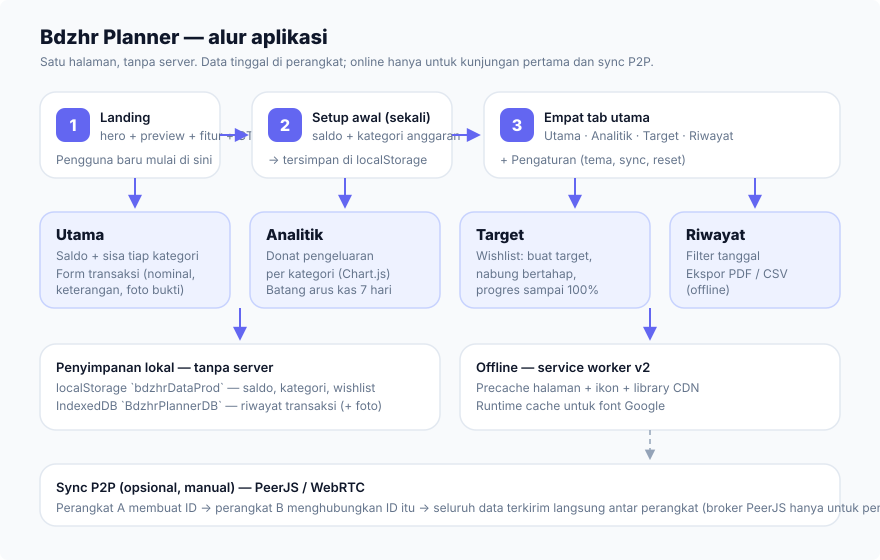

# Arsitektur — Bdzhr Planner

## Ringkasan

Bdzhr Planner adalah PWA statis satu halaman, tanpa build step dan tanpa
backend. Seluruh aplikasi tinggal di `index.html` (±90 KB: markup + CSS +
JavaScript), dengan `manifest.json` dan `sw.js` sebagai lapisan PWA.
Live di https://planku.pages.dev (Cloudflare Pages, deploy dari branch
`main`).



## Peta file

| File | Peran |
|---|---|
| `index.html` | Seluruh aplikasi: markup, style (Tailwind CDN + CSS variabel tema), dan semua logika JS |
| `manifest.json` | Manifest PWA: nama, warna, `start_url`, ikon lokal |
| `sw.js` | Service worker v2: precache + runtime cache font |
| `icon-192.png` | Ikon PWA 192×192 (`purpose: any`) |
| `icon-512.png` | Ikon PWA 512×512 (`purpose: maskable`) |
| `docs/architecture.md` | Dokumen ini |
| `docs/diagrams/app-flow.svg` | Diagram alur aplikasi |

## Alur aplikasi

```
Kunjungan pertama (online)
  → landingView (gaya SaaS): navbar + hero + preview produk + fitur + cara kerja + CTA band + footer → tombol "Mulai Atur Uang"
  → setupView: isi saldo awal + alokasi tiap kategori → Simpan Konfigurasi
  → state disimpan di localStorage (bdzhrDataProd)
  → mainSpaView: 4 tab lewat bottom nav
      Utama     — saldo, kartu anggaran, form transaksi
      Analitik  — donat pengeluaran + batang arus kas 7 hari (Chart.js)
      Target    — wishlist: buat target, nabung, progres bar
      Riwayat   — daftar transaksi, filter tanggal, ekspor PDF/CSV
  → Pengaturan (modal): tema Dark/Light/Pink, sync P2P, reset total
```

## Landing & onboarding

Pengguna baru pertama kali melihat `landingView` — halaman depan gaya
SaaS, bukan langsung form setup:

- **Navbar sticky** (`<header>`): logo Bdzhr Planner di kiri, tautan
  Fitur (`#fitur`) dan Cara Kerja (`#howItWorks`) di tengah, lalu di
  kanan ikon logo GitHub resmi (SVG mark, `aria-label="Lihat di
  GitHub"`) yang mengarah ke https://github.com/dezzorigin/bdzhr-planner
  (tab baru) + tombol CTA "Mulai Atur Uang". Navbar hanya tampil di
  landing: `showLanding()` menampilkannya, `startSetup()` dan
  `checkSetup()` (saat state sudah ada) menyembunyikannya lewat
  `#landingNavWrap`. Repo ini publik, jadi tautan GitHub memang boleh
  diklik siapa saja.
- **Hero dua kolom** (desktop; menumpuk di ponsel): kiri badge, headline
  "Uangmu, rapi tanpa ribet." + subcopy yang sama seperti sebelumnya, 2
  CTA (primer "Mulai Atur Uang →" ke setup, sekunder "Lihat cara kerja"
  anchor ke `#howItWorks`); kanan kartu "Contoh tampilan" yang sudah ada
  dirapikan jadi pratinjau produk (chrome bar browser + pill
  `planku.pages.dev`, ringkasan bulan ini, keterangan "data contoh").
- **Section bawah**: grid 6 fitur (konten sama), cara kerja 3 langkah,
  catatan privasi (offline, tanpa akun, tanpa server), CTA band, footer
  sederhana (tautan GitHub + live).
- Landing keluar dari container `max-w-md` milik `<main>` lewat CSS
  `#landingView { width: 100vw; margin-left: calc(50% - 50vw); }`
  (dengan `overflow-x: clip` di `html, body` supaya tidak ada scroll
  horizontal). Setup dan dashboard tidak berubah — tetap `max-w-md`.

`startSetup()` membuka `setupView`; pengguna lama (state sudah ada di
`localStorage`) langsung masuk `mainSpaView`. Setup menampilkan ringkasan alokasi live
("Dialokasikan Rp X dari Rp Y · Sisa Rp Z") dan peringatan bila total
anggaran melebihi saldo. Semua validasi form memakai pesan inline di
halaman (bukan `alert()`); konfirmasi penghapusan data tetap memakai
dialog `confirm()` bawaan browser.

## Model data

### `localStorage` — kunci `bdzhrDataProd`

```jsonc
{
  "balance": 1000000,                 // saldo utama (Rp)
  "buckets": [
    { "id": "bkt_1", "name": "Kebutuhan Pokok", "allocated": 600000, "current": 550000 }
  ],
  "wishlists": [
    { "id": "wl_...", "name": "iPhone 15", "target": 15000000, "saved": 500000 }
  ]
}
```

Aturan mainnya:

- Pengeluaran per kategori mengurangi `balance` **dan** `current` kategori itu.
- Pemasukan menambah `balance` saja.
- Nabung wishlist mengurangi `balance`, menambah `saved`, dan mencatat transaksi minus "Tabungan / Wishlist".
- Hapus kategori/wishlist mengembalikan sisa uangnya ke `balance`.
- Tema tersimpan terpisah di `localStorage` kunci `bdzhr_theme`.

### IndexedDB — database `BdzhrPlannerDB`, store `transactions`

```jsonc
{
  "id": 1763434...,                   // Date.now()
  "amount": 50000,
  "note": "Makan Siang",
  "typeLabel": "Kebutuhan Pokok",     // atau "Pemasukan" / "Pengeluaran Tak Terduga" / "Tabungan / Wishlist"
  "isMinus": true,
  "timestamp": "18/11/2026 08:20",    // format tampil
  "rawDate": "2026-11-18",            // untuk filter & grafik 7 hari
  "photo": null                       // base64 data URL bila ada foto bukti
}
```

Transaksi **hanya** di IndexedDB (bukan `localStorage`), supaya foto bukti
dan riwayat panjang tidak menekan batas `localStorage`.

## PWA & offline

- `manifest.json`: `display: standalone`, `start_url: ./`, ikon lokal
  192 (`any`) + 512 (`maskable`), `theme_color #6366f1`.
- `sw.js` v2 (`CACHE_NAME = 'bdzhr-v2'`):
  - **Precache** saat install: `/`, `index.html`, `manifest.json`,
    kedua ikon, dan semua library CDN (Tailwind, Font Awesome,
    html2pdf.js, Chart.js, PeerJS, CSS font Inter). Satu URL gagal
    tidak menggagalkan install.
  - **Runtime cache** untuk font Google (`fonts.googleapis.com` /
    `fonts.gstatic.com`): cache-first, isi dari network bila ada.
  - **Lainnya**: cache-first, fallback network. Cache lama dihapus saat
    `activate`, lalu `clients.claim()`.
- Catatan jujur: mode offline baru jalan **setelah satu kunjungan
  online** (service worker harus ter-install dulu), dan service worker
  hanya aktif lewat `http(s)://`, bukan `file://`.

## Sinkronisasi P2P (PeerJS)

- Perangkat A menekan tombol power di Pengaturan → PeerJS membuat ID
  perangkat (broker publik PeerJS).
- Perangkat B memasukkan ID itu → koneksi WebRTC langsung → seluruh
  `state` + riwayat transaksi dikirim dan diterapkan di penerima
  (menimpa data lokal penerima).
- Data berpindah langsung antar perangkat; yang lewat broker PeerJS
  hanya pensinyalan (jabat tangan) koneksi. Kedua perangkat harus
  online bersamaan; tidak ada antrean bila salah satu offline.

## Dependensi eksternal (semua CDN, versi ter-pin)

| Library | URL | Dipakai untuk |
|---|---|---|
| Tailwind CSS | `cdn.tailwindcss.com` | Utility CSS |
| Font Awesome 6.4.0 | `cdnjs.cloudflare.com` | Ikon |
| Inter | `fonts.googleapis.com` | Font |
| html2pdf.js 0.10.1 | `cdnjs.cloudflare.com` | Ekspor PDF |
| Chart.js | `cdn.jsdelivr.net` | Grafik analitik |
| PeerJS 1.5.2 | `unpkg.com` | Sync P2P |

## Catatan Lighthouse

Lighthouse 12 menghapus kategori PWA dari laporannya (tidak ada lagi
audit `installable-manifest`, `service-worker`, atau `offline-start-url`),
jadi CI mengunci aksesibilitas ≥ 0,90 dan best-practices ≥ 0,90
(terukur lokal 100/100 pada 2026-11-18) serta performance ≥ 0,60
sebagai peringatan (terukur 72 — beban utama adalah skrip CDN yang
render-blocking; Chart.js, PeerJS, dan html2pdf.js sudah `defer` karena
baru dipakai saat pengguna beraksi). PWA — manifest, service worker
aktif, cache `bdzhr-v2`, dan reload offline — diverifikasi terpisah
oleh skrip play-test lokal (`ci-tools/play-bdzhr.mjs` di direktori
kerja), bukan oleh Lighthouse.

## Catatan validasi HTML

Dropdown jenis transaksi adalah combobox kustom yang disengaja (opsi
berwarna + header + separator, dukungan keyboard via `role="combobox"`
dan `aria-expanded`) — bukan `<select>` bawaan. Karena itu aturan
`prefer-native-element` html-validate dimatikan di `.htmlvalidate.json`.

## Keterbatasan yang diketahui

1. **Anggaran sekali setup.** Tidak ada anggaran bulanan berulang
   otomatis; alokasi baru ditambah manual.
2. **Foto bukti base64.** Tidak dikompres; foto besar membengkak di
   IndexedDB.
3. **Sync menimpa, bukan menggabung.** Data penerima diganti seluruhnya
   dengan data pengirim; tidak ada merge per transaksi.
4. **`user-scalable=no, maximum-scale=1.0`.** Sengaja (rasa aplikasi),
   tapi mengorbankan zoom aksesibilitas.
5. **Tanpa cloud backup.** Bila browser di-reset dan tidak ada ekspor
   atau sync, data hilang.
6. **Kelas Tailwind `dark:` tidak pernah aktif.** Mesin tema memakai
   class `theme-dark` / `theme-light` / `theme-pink` di `<html>`,
   sementara Tailwind dikonfigurasi `darkMode: 'class'` — jadi varian
   `dark:` (mis. `dark:bg-red-900/30`) tidak pernah terpicu karena
   class `dark` tidak pernah dipasang. Warna tetap konsisten karena
   variabel CSS tema yang mengatur warna; kelas `dark:` itu kode mati.
